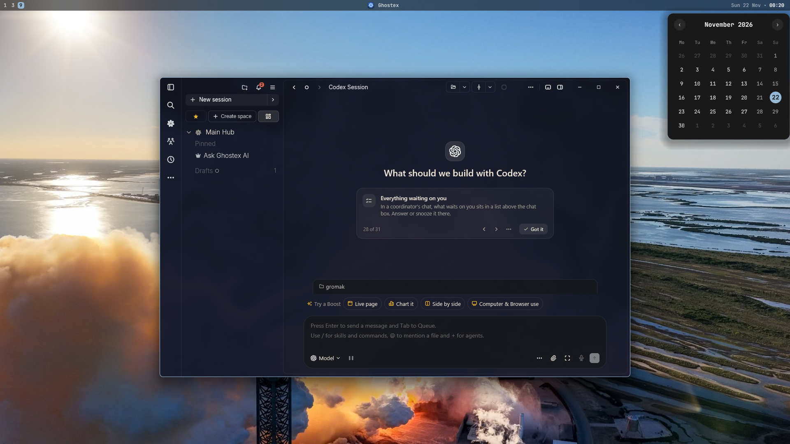
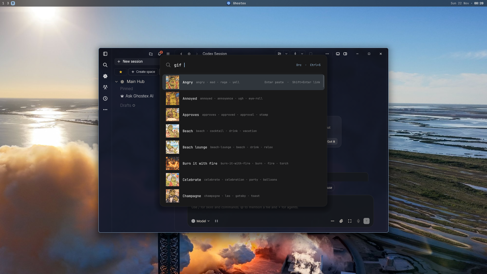
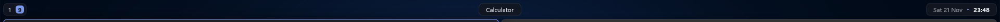
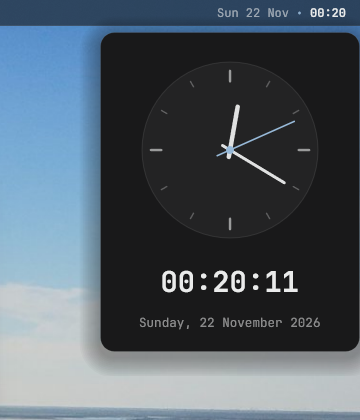
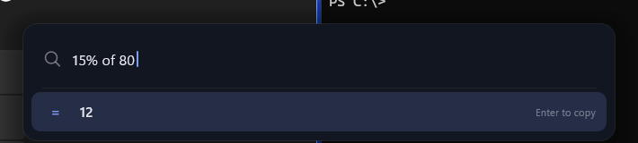
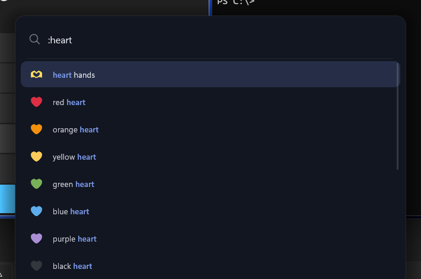
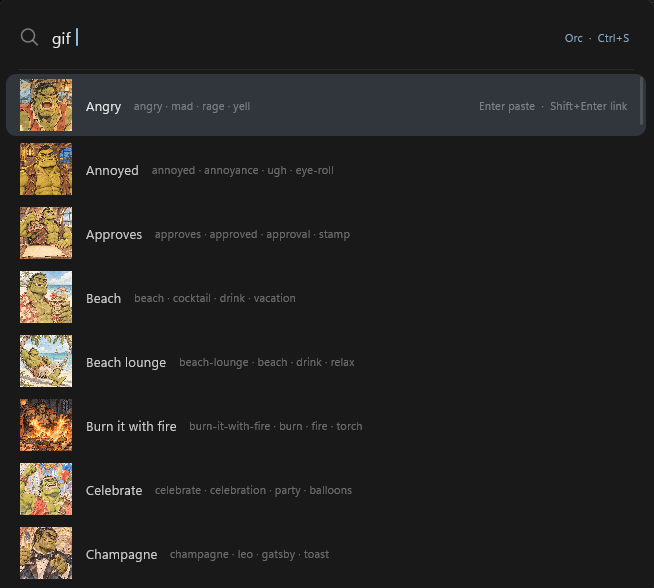

# gromak

**A minimal, keyboard-driven tiling window manager for Windows, inspired by Hyprland.**

gromak arranges your windows into a clean dwindle layout with gaps, gives you
ten workspaces per monitor that you can flip between instantly, and stays out of
the way: one slim, blurred bar per monitor, a coloured border on the focused
window, and nothing else.







<p align="center"></p>

> **Status:** early (v0.1). It is usable day to day, but expect rough edges.
> If gromak ever exits unexpectedly, run `gromak --restore` to bring back
> windows that were on hidden workspaces and turn Windows Snap back on.

## Features

- **Dwindle tiling.** Every new window splits the focused tile along its longer side.
- **Ten workspaces per monitor.** Every monitor has its own workspaces 1–10.
  `mod+1…0` switches on the monitor under the pointer, `mod+shift+1…0` moves
  the focused window there and follows it, and `mod+ctrl+1…0` sends it
  without following.
- **Keyboard-first.** Move focus, swap, resize, float, fullscreen, and close
  windows without touching the mouse. The commands use Hyprland's names
  (`movefocus`, `togglefloating`, `workspace e+1`…).
- **Mouse-friendly too.** Hold `mod` and drag any window: drop it on another
  tile to swap, on another monitor to move it, or on a bar workspace pill to
  send it to that workspace. `mod`+right-drag resizes. You can also drag by
  the title bar, click or scroll the bar, and use `mod`+scroll.
- **Focus follows mouse (optional).** Focus moves to whatever window the pointer
  is over, and the pointer follows when you move focus with the keyboard, like
  Hyprland's `follow_mouse`. Turn it on with `focus_follows_mouse = true`.
- **App launcher.** `mod+Space` opens a rofi-style search panel with every
  installed app (desktop and Store), real icons, fuzzy matching and
  most-used-first ranking. If nothing matches, Enter runs what you typed.
  It also has a calculator, an emoji picker (`:`) and an
  [orc.pictures](https://orc.pictures) GIF picker (`gif `).
- **Flat, modular bar.** One slim strip along the top of each monitor (or
  floating islands with `style = "islands"`) built from widgets you place
  yourself, like waybar's modules: workspaces, the focused window, clock, Wi-Fi,
  Bluetooth, CPU, memory and volume, plus `custom/*` widgets that show the
  output of any command. Click a widget for its panel: join Wi-Fi networks,
  switch Wi-Fi or Bluetooth, watch CPU and memory graphs, set the volume.
- **Goeist built in.** The bar and its panels use Goeist and Goeist Mono
  (rounded Geist, SIL Open Font License), embedded in gromak, so nothing needs
  installing.
- **Themed by your wallpaper.** The bar and the focused window's border take
  their colours from your desktop wallpaper and follow it when it changes,
  in dark or light mode. You can also use your Windows accent colour, or
  your own colours.
- **Focus borders.** Uses Windows 11's native DWM window borders.
- **Window rules.** Float, ignore, or pin windows to workspaces by exe, class, or title.
- **Multi-monitor and per-monitor DPI aware.** Gaps and the bar scale with each display.
- **Workspaces for AI agents.** `gromak mcp` lets an agent claim a workspace
  on the monitor you name and work there through
  [agent-desktop](https://github.com/vercel-labs/agent-desktop) without
  touching your mouse, keyboard focus or screen. See [AI agents](#ai-agents-mcp).
- **Safe.** Hidden windows are tracked on disk and restored on exit, logoff,
  crash recovery, or `gromak --restore`. No DLL injection and no admin rights required.
- **Small.** A single executable of about 2.3 MB, fonts included, with no runtime dependencies.

## Resource usage

Measured on Windows 11 with two 1080p monitors, a release build, and the
launcher used a few times:

| | |
|---|---|
| RAM (working set) | ~100 MB |
| RAM (private) | ~85 MB |
| CPU | ~0% when idle; it only wakes on window events, input and animations |
| Executable | ~2.3 MB |

Most of that memory isn't gromak itself. The bar, launcher and popups are
drawn on the GPU with Direct2D, which loads your graphics driver (often 40 MB
or more). Listing your apps and their icons in the launcher loads the
Windows shell libraries. App icons and GIF previews are cached after first
use, so the launcher opens instantly.

## Requirements

- Windows 10 1809+ or Windows 11. Coloured focus borders need Windows 11.
- To build from source: [Rust](https://rustup.rs) (stable, MSVC toolchain).

## Install

### Installer (recommended)

Download `gromak-<version>-setup.exe` from the
[latest release](https://github.com/radiumcoders/gromak/releases/latest) and
run it. It installs for your user only (no administrator prompt) and:

- adds **gromak** to the Start menu;
- can start gromak when you sign in (ticked by default). Turn this on or off
  later in Task Manager → Startup apps;
- registers an uninstaller under Settings → Apps.

Running a newer installer upgrades in place and keeps your choices.
Uninstalling quits gromak cleanly first and leaves your config in
`%USERPROFILE%\.config\gromak` alone.

> The builds aren't code-signed yet, so Windows SmartScreen may say
> "Windows protected your PC". Click **More info → Run anyway**. Each
> release lists SHA-256 checksums if you want to verify the download.

### Portable

Download `gromak-<version>-x64.exe` from the same release, put it anywhere,
and run it. To start it at sign-in, press `Win+R`, run `shell:startup`, and
put a shortcut to it in that folder.

### From source

```powershell
git clone https://github.com/radiumcoders/gromak
cd gromak
cargo build --release
.\target\release\gromak.exe
```

To build the installer yourself, install
[Inno Setup 6](https://jrsoftware.org/isinfo.php)
(`winget install JRSoftware.InnoSetup`) and run
`powershell -File installer\build.ps1`. The installer, the portable exe and
the checksums end up in `target\installer\`.

## Default keybindings

`mod` is **Alt** by default. Set `general.mod` to `"win"` or `"ctrl+alt"` in
the config to change it. With `mod = "win"`, gromak takes over Windows' own
Win+key shortcuts (Win+1…9, Win+D, …) through a low-level keyboard hook, and
pressing Win on its own still opens the Start menu. The one exception is
**Win+L**, which always locks the PC, so use the arrow-key bindings for
moving focus right.

| Keys | Action |
| --- | --- |
| `mod+Enter` | Open a terminal (`general.terminal`, Windows Terminal by default) |
| `mod+Space` | Open the app launcher |
| `mod+Q`, `mod+W` | Close the focused window |
| `mod+H/J/K/L`, `mod+←↓↑→` | Move focus (crosses monitors at the edge) |
| `mod+Shift+H/J/K/L`, `mod+Shift+←↓↑→` | Swap with neighbour (or move to the next monitor) |
| `mod+Ctrl+H/J/K/L` | Move the nearest divider |
| `mod+1` … `mod+0` | Switch to workspace 1–10 |
| `mod+Shift+1` … `mod+Shift+0` | Move window to workspace 1–10 and follow it |
| `mod+Ctrl+1` … `mod+Ctrl+0` | Send window to workspace 1–10 without following it |
| `mod+.` / `mod+,` | Next / previous workspace |
| `mod+N` / `mod+Shift+N` | Focus next / previous window |
| `mod`+drag | Move a window (drop on a tile, a monitor or a bar workspace pill) |
| `mod`+right-drag | Resize a floating window, or move a tile's split |
| `mod`+scroll | Focus next / previous window |
| `mod+Shift`+scroll | Next / previous workspace |
| `mod+V` | Toggle floating |
| `mod+F` | Fullscreen within the tiling area (keeps gaps and bar) |
| `mod+Shift+F` | True fullscreen |
| `mod+T` | Toggle the split direction |
| `mod+Shift+R` | Reload the config |
| `mod+Shift+E` | Exit gromak (restores all windows) |

## Configuration

The config lives at `%USERPROFILE%\.config\gromak\gromak.toml` and is created
with commented defaults on first launch. Edit it, then press `mod+Shift+R` to
reload. If the file has an error, gromak says so in the bar and keeps the
previous config.

```toml
[general]
gaps_in = 4
gaps_out = 6
mod = "alt"
terminal = "wt.exe"
hide_taskbar = false
focus_follows_mouse = false
start_menu = "tap"       # or "double_tap" / "never" (also blocks Ctrl+Esc)
mouse_drag = true
disable_snap = true      # turn off Windows Snap while gromak runs

[theme]
source = "wallpaper"  # or "accent" or "manual"
mode = "auto"          # follow Windows light/dark, or "dark" / "light"

[animations]
enabled = true         # windows glide into place, workspaces slide in
duration_ms = 220

[decoration]
borders = true
active_border = "#8aadf4"
inactive_border = "#363a4f"

[bar]
enabled = true
style = "islands"       # or "full"
blur = true             # frosted-glass backdrop (full style)
height = 26
opacity = 0.55       # background opacity, 0.0 - 1.0
corner_radius = 10
font = "Goeist"           # built in; or an installed family / a .ttf file
font_mono = "Goeist Mono" # numbers: clock, percentages
font_size = 12
modules_left = ["workspaces"]
modules_center = ["window"]
modules_right = ["cpu", "memory", "volume", "network", "bluetooth", "clock", "custom/weather"]
background = "#181926"
foreground = "#cad3f5"
accent = "#8aadf4"

[bar.custom.weather]       # shown by "custom/weather"
exec = "curl -s \"wttr.in/?format=%c%t\""
interval = 900
on_click = "start https://wttr.in"

[[rules]]
exe = "Spotify.exe"
workspace = 9

[[rules]]
title = "Picture-in-Picture"
float = true

[binds]
"mod+return" = "exec $terminal"
"mod+b" = "exec firefox.exe"
"mod+1" = "workspace 1"
# ...
```

The full reference, including every dispatcher, is in
[`config/default.toml`](config/default.toml). You can also print it with
`gromak --default-config`.

### App launcher

`mod+Space` opens the launcher on the focused monitor. Start typing to
filter. Matching is fuzzy, so `vsc` finds Visual Studio Code and `term`
finds Terminal, and the matched letters are highlighted.

| Key | Action |
| --- | --- |
| `↑` `↓`, `Tab` `Shift+Tab`, `Ctrl+J` `Ctrl+K` | Move the selection |
| `PgUp` `PgDn` | Move a page |
| `Enter` | Open the selected app (or run the text as a command if nothing matches) |
| `Esc` | Close |
| `Ctrl+Backspace` | Delete a word |
| `Ctrl+V` | Paste |

The list is the same as Start's "All apps" (`shell:AppsFolder`), including
Microsoft Store apps. Apps you launch often move to the top. The launch
counts are kept in `%LOCALAPPDATA%\gromak\launcher_history.txt`.

#### Power and session

Type `shut`, `restart`/`reboot`, `sleep`, `hibernate`, `lock` or
`logout` to get **Shut down**, **Restart**, **Sleep**, **Hibernate**,
**Lock** and **Sign out**. Lock and Sleep happen at once. The others ask for
a second Enter: the row changes to "Press Enter again to shut down", so a
stray keypress can't end your session.

#### Calculator



Type maths and the answer appears as the first result. Enter copies it to
the clipboard. Start with `=` to use only the calculator.

```
2+3*4            → 14
15% of 80        → 12
sqrt(2)^2 + 5!   → 122
(1,000 - 25) / 3 → 325
```

It supports `+ - * / ^`, parentheses, percentages, `mod`, factorials,
implicit multiplication (`2pi`), `pi`, `tau` and `e`, and the functions
`sqrt cbrt abs exp ln log log2 sin cos tan asin acos atan floor ceil round`.

#### Emoji picker



Type `:` followed by a name, such as `:fire` or `:thumbs`, to search
emoji. Enter types the emoji into the window you were using, then restores
your clipboard. To use a different emoji style, point `[launcher]
emoji_font` at an installed font or a `.ttf` file. For example, Twemoji, the
style used by Discord:

```toml
[launcher]
emoji_font = "fonts/Twemoji.Mozilla.ttf"   # relative to the config folder
```

Download `Twemoji.Mozilla.ttf` from
[mozilla/twemoji-colr](https://github.com/mozilla/twemoji-colr/releases).

#### GIF picker (orc.pictures)



Type `gif ` followed by a search, such as `gif angry` or `gif fire`, to
browse the [orc.pictures](https://orc.pictures) reaction-GIF catalog, with
thumbnails. **Enter** pastes the GIF into the window you were using.
**Shift+Enter** copies its link instead.
Every GIF comes in two styles, orc and Videorc. Press **Ctrl+S** in the picker
to switch between them, and set the default with `[launcher] gif_style =
"orc"` or `"videorc"`.

The GIF goes on the clipboard as a file, the same way Explorer copies one,
so it stays animated when pasted into Discord, Slack, a browser upload field
or a folder. The catalog, thumbnails and GIFs are cached in
`%LOCALAPPDATA%\gromak\orc\`. Each file is downloaded once, and the catalog
is refreshed every six hours. GIFs are made by
[OrcDev](https://orcdev.com) and fetched from the public site; gromak does
not bundle any of them.

### Theme

By default, gromak picks its colours from your wallpaper. It finds the most
vivid colour in the image and uses it as the accent (the active workspace
pill, the clock dot and the focused window's border). It then tints the bar
with the image's overall tone. When you change the wallpaper, or a slideshow
moves on, the colours update within a few seconds. Black-and-white wallpapers
fall back to your Windows accent colour.

| `[theme]` option | Values |
| --- | --- |
| `source` | `"wallpaper"` (default), `"accent"` (the Windows accent colour), or `"manual"` (the colours in `[bar]` and `[decoration]`) |
| `mode` | `"auto"` (follow Windows' light/dark setting, the default), `"dark"`, or `"light"` |

### Hiding the Windows taskbar

Set `hide_taskbar = true` under `[general]` to hide the Windows taskbar while
gromak runs (for example if you use another taskbar or launcher). Windows are
then tiled over the full screen, and the taskbar comes back when gromak exits.
If Explorer re-shows it, gromak hides it again.

### Windows Snap

While gromak runs, Windows' own snapping is turned off: dragging a window to
a screen edge, the Snap Layouts flyout (top of the screen and the maximize
button), and Snap Assist. Otherwise Windows would resize windows behind the
tiler's back. This is the "Snap windows" switch in Settings → System →
Multitasking. Your previous setting comes back when gromak exits or you log
off. If gromak ever crashes, it is restored the next time gromak starts, or
by `gromak --restore`. Set `disable_snap = false` under `[general]` to leave
Snap alone.

### Window rules

A rule matches windows on any combination of `exe`, `class`, and `title`.
Matching ignores case, and `title` matches a substring. A matching rule can:

- `float = true`: never tile the window.
- `ignore = true`: leave the window completely alone.
- `workspace = N`: open the window on workspace N.

Run `gromak --list-windows` to see the exe, class, and title of every window
you could write a rule for.

### Dispatchers

| Dispatcher | Effect |
| --- | --- |
| `exec <command>` | Run a command (`$terminal` expands to `general.terminal`) |
| `launcher` | Open the app launcher (or close it if open) |
| `killactive` | Close the focused window |
| `togglefloating` | Float or tile the focused window |
| `fullscreen [0\|1]` | `0`: cover the monitor. `1`: fill the tiling area |
| `togglesplit` | Flip the split the focused window sits in |
| `movefocus <l\|r\|u\|d>` | Focus the neighbour in a direction |
| `movewindow <l\|r\|u\|d>` | Swap with the neighbour in a direction |
| `resizeactive <l\|r\|u\|d>` | Move the nearest divider in a direction |
| `cyclenext` / `cycleprev` | Focus the next or previous window |
| `workspace <1-10\|e+N\|e-N>` | Switch workspace |
| `movetoworkspace <n>` | Move the window there and follow it |
| `movetoworkspacesilent <n>` | Move the window there and stay |
| `reload` | Reload the config |
| `exit` | Quit, restoring every window |

## AI agents (MCP)

gromak can give an AI agent ("clanker") a workspace of its own, so it can use
desktop apps while you keep working. `gromak mcp` is a
[Model Context Protocol](https://modelcontextprotocol.io) server. Pair it with
Vercel's [agent-desktop](https://github.com/vercel-labs/agent-desktop), which
operates apps through UI Automation, without the mouse or your keyboard focus:

- **gromak** gives the agent a workspace on the monitor you name ("top",
  "bottom", "left", "right", "primary" or a number), starts apps there, and
  lists their windows.
- **agent-desktop** reads and operates those windows: snapshots, clicks,
  filling in fields, screenshots.

While you look at another workspace, the agent's windows are moved just
off-screen rather than hidden: they keep running and can still be driven,
but you never see them and they never take your focus. If one tries, gromak
gives focus straight back to your window. To watch the agent, switch to its
workspace like any other; its number is drawn in the accent colour on the bar.

### Setup

```powershell
npm install -g agent-desktop
claude mcp add gromak -- "$env:LOCALAPPDATA\Programs\gromak\gromak.exe" mcp
claude mcp add agent-desktop -- cmd /c agent-desktop mcp
```

Other MCP clients take the same two servers as JSON:

```json
{
  "mcpServers": {
    "gromak": { "command": "C:\Users\you\AppData\Local\Programs\gromak\gromak.exe", "args": ["mcp"] },
    "agent-desktop": { "command": "cmd", "args": ["/c", "agent-desktop", "mcp"] }
  }
}
```

gromak must be running. Then ask the agent things like *"on the bottom
monitor, open Calculator and work out 7 + 2"*. The tools are
`gromak_monitors`, `gromak_claim_workspace`, `gromak_launch`,
`gromak_windows`, `gromak_move_window`, `gromak_close_window` and
`gromak_release_workspace`. gromak's MCP instructions tell the agent to stay
headless in agent-desktop (no `--headed`, `focus-window`, `type`, `press` or
mouse commands), since those would act on your screen.

Things to know:

- Store apps such as Calculator start through a helper process. For a few
  seconds after such a launch, the next new window counts as the app's, so a
  window you open in that moment could end up on the agent's workspace.
- Parked windows still appear in Alt+Tab. Picking one sends focus back to
  your window; switch to the agent's workspace to look at it.
- gromak listens on a local named pipe. Remote machines are refused, and only
  programs running as you (or as an administrator) can send it requests.

## Command line

```
gromak                  start the window manager
gromak --list-windows   print exe, class and title of tileable windows
gromak --check-config   validate the config file
gromak --config-path    print where the config file lives
gromak --default-config print the default config
gromak --quit           exit the running gromak cleanly (like mod+shift+e)
gromak mcp              serve the MCP tools that give AI agents a workspace
gromak --restore        undo what a crashed session left behind
                        (hidden windows, off-screen windows, Windows Snap
                        and window shadows turned off)
gromak --version
gromak --help
```

The log is written to `%LOCALAPPDATA%\gromak\gromak.log`. Release builds are
windowed apps with no console. A debug build (`cargo run`) also streams the
log to the terminal.

## Compatibility with other apps

gromak only intercepts the exact key combinations in your `[binds]`, plus
the mouse wheel while a bound modifier is held. Every other shortcut reaches
your apps unchanged. With `mod = "win"`, that includes Ctrl/Alt/Shift
shortcuts, Ctrl+scroll zoom and Shift+scroll. Windows' own Win shortcuts keep
working unless you bind the same combination. To keep one, such as Win+V for
clipboard history or Win+N for notifications, remove or rebind that line in
`[binds]`.

## Known limitations

- **Elevated windows.** Windows running as administrator (Task Manager,
  installers) can only be managed if gromak itself runs as administrator.
  Otherwise they are left untouched.
- **Alt shortcuts.** With `mod = "alt"`, gromak's bindings take precedence
  over apps' Alt shortcuts. Use `win` or `ctrl+alt` if that bothers you.
- **Win key.** Win+L always locks Windows and cannot be rebound. While an
  elevated window has focus, Win-key bindings only work if gromak also runs as
  administrator.
- **Hidden workspaces hide taskbar buttons.** Windows on workspaces that aren't
  shown are hidden, so their taskbar buttons disappear until you switch back.

## Roadmap

- Resizing tiles by dragging their edges
- Per-workspace layouts (master/stack, monocle)
- Named and persistent workspaces, scratchpad
- A `gromak msg` command for scripting (the agent pipe is a start)
- More bar modules (battery)

## Building and contributing

See [CONTRIBUTING.md](CONTRIBUTING.md) to get started and
[docs/ARCHITECTURE.md](docs/ARCHITECTURE.md) for how gromak works inside.

## License

[MIT](LICENSE)
